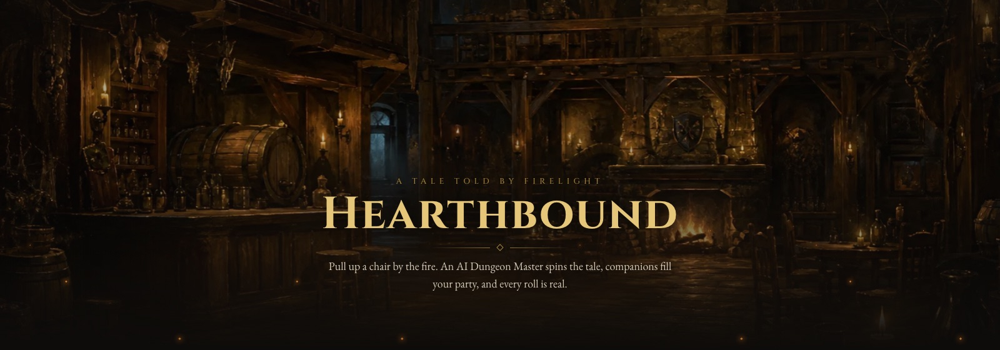
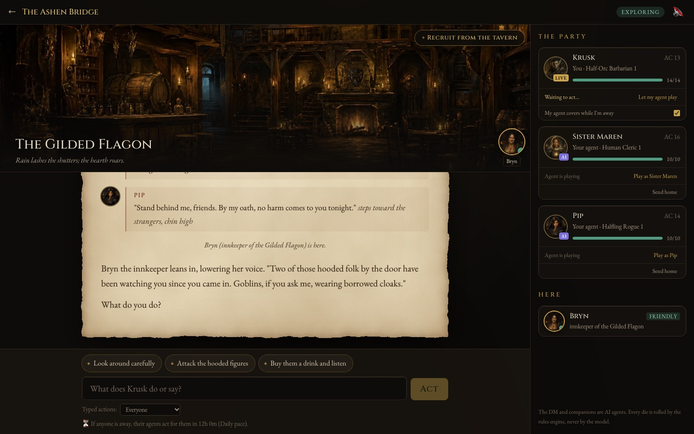
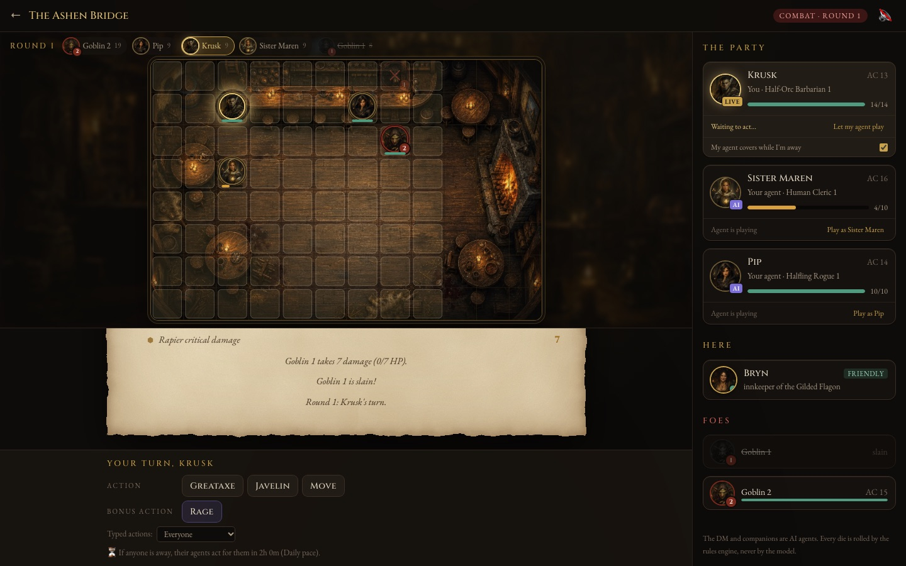
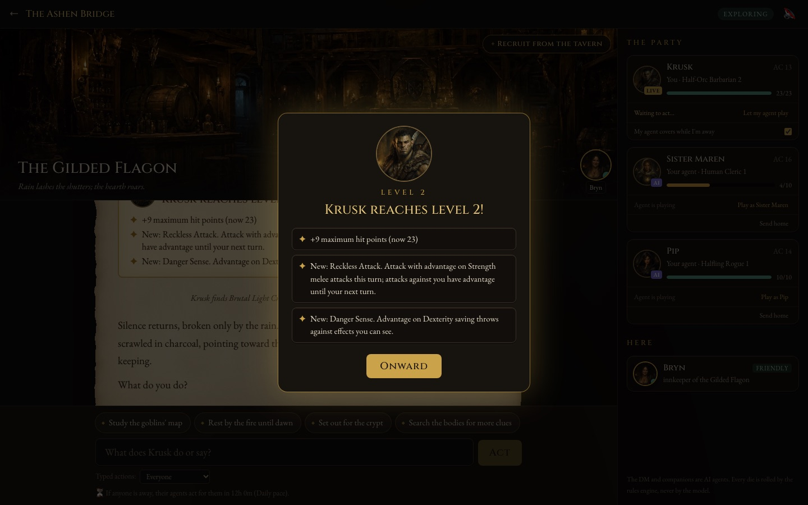
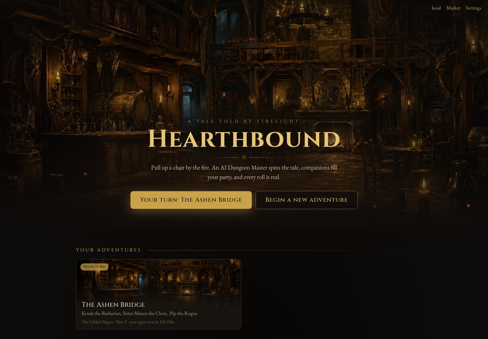
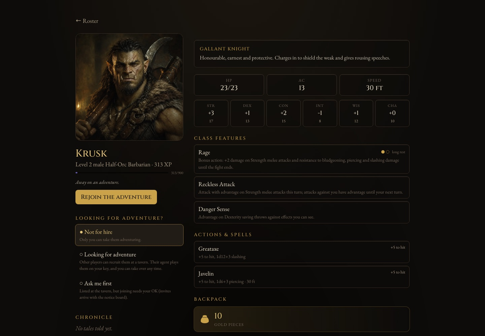

  

  <b>A 5e-compatible fantasy tabletop RPG with an AI table, solo or with friends.</b> 
  An AI Dungeon Master spins the tale, companions fill your party, and every roll is real.

---

Pull up a chair. A Claude-powered **Dungeon Master** runs the world and voices
its people. The rest of your party are your own heroes, played by their
**agents** in the personalities you gave them, and you can take over any of them
at any time. A deterministic **5e rules engine** (SRD 5.1) owns every die roll,
hit point and turn, so the AI narrates and decides but can't fudge the numbers.

  

## At the table

- **A living story.** The narration streams onto parchment and is read aloud if you like, with every character in their own voice. NPCs step onto the table with their portraits. Quick choices are always on offer.
- **Real combat.** A battle map with numbered tokens, initiative and animated dice. Actions, bonus actions and class features work as in 5e: Rage, Sneak Attack, Action Surge, Bardic Inspiration, Fireball and the rest.
- **Heroes who grow.** Levels 1 to 5, with SRD class features, ability score improvements and new spells, all shown on a level-up screen.
- **Persistent characters.** Your roster keeps its XP, gear, gold and chronicle from one adventure to the next. The fallen rest in the Hall of the Fallen.
- **Play together, at your own pace.** Recruit friends' heroes at the tavern. When someone is away, their hero's agent plays for them until they're back.
- **Loot worth trading.** Rolled items with rarities and affixes, equipment slots, a player market and a town shop, all on a gold ledger the realm's owner can steer.
- **The candlelit look.** A painted art pack for every scene, monster, race and class, with sound effects and ambience that follow the scene.

<table>
  <tr>
    <td width="50%"></td>
    <td width="50%"></td>
  </tr>
  <tr>
    <td width="50%"></td>
    <td width="50%"></td>
  </tr>
</table>

## Under the hood

A single Go binary (Clean Architecture, SQLite, server-sent events) with the
React UI embedded. Each player's agents run on **their own Anthropic key**
within a daily cap, and the server is invite-only. An offline `-demo` mode runs a
scripted table on its own save file. The binary and settings still use the
working name `tabletop` (`bin/tabletop`, `TABLETOP_*`).

| Doc | For |
|---|---|
| [Quickstart.md](Quickstart.md) | building, running, configuring, debugging, your save data |
| [docs/ART_PACKS.md](docs/ART_PACKS.md) | stock art packs: generating them, making your own style |
| [docs/ROADMAP.md](docs/ROADMAP.md) | what's built, design rules, and what comes next |
| [docs/DEPLOY.md](docs/DEPLOY.md) | hosting your own realm: Docker, HTTPS, backups |
| [CONTRIBUTING.md](CONTRIBUTING.md) | how to help: setup, the definition of done, house rules |
| [CLAUDE.md](CLAUDE.md) | conventions for working on the code (also read by AI coding sessions) |
| [SECURITY.md](SECURITY.md) | reporting a vulnerability privately |

## Licence

The code is free software under the [GNU Affero General Public License v3.0](LICENSE)
(AGPL-3.0): you may run, study, change and share it, and if you run a modified
version as a public server, you must offer its source to your players. The
stock art in `web/public/stock` is licensed under
[CC BY 4.0](web/public/stock/LICENSE.md).

## Legal

This work includes material taken from the System Reference Document 5.1
("SRD 5.1") by Wizards of the Coast LLC and available at
https://dnd.wizards.com/resources/systems-reference-document. The SRD 5.1 is
licensed under the Creative Commons Attribution 4.0 International License
available at https://creativecommons.org/licenses/by/4.0/legalcode.

This project is not affiliated with, endorsed by or sponsored by Wizards of the
Coast. "Dungeons & Dragons" is a trademark of Wizards of the Coast LLC.
